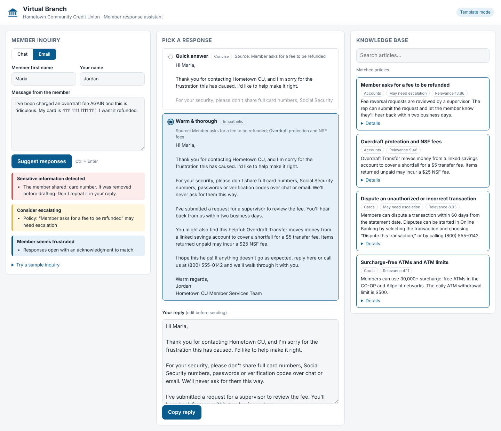

# Virtual Branch

A response assistant for credit union contact center reps who answer member inquiries over online chat and email.

The rep pastes the member's message. Virtual Branch searches the credit union's knowledge base and suggests several friendly, professional replies. The rep picks one from the list, edits it if needed, and copies it into the chat or email.



## What it does

- **Knowledge base lookup.** Finds the most relevant articles for each inquiry (BM25 ranking plus keyword phrase matching) and shows them beside the replies, including internal rep notes.
- **Pick-list responses.** Usually three or four options: *Quick answer*, *Step-by-step*, *Warm & thorough*, and a *Clarifying question* when the inquiry is ambiguous. Each option names the article it's based on.
- **Chat or email formatting.** Chat replies are short and conversational. Email replies have a greeting, full paragraphs, and a sign-off with the rep's name and team signature.
- **Tone matching.** Detects frustration, worry or grief and opens with a sincere acknowledgment or condolences.
- **Sensitive data protection.** Detects card numbers (Luhn-checked), Social Security numbers, account numbers and passwords in the member's message. It warns the rep, strips that data before anything is drafted or sent to the AI, and adds a kind security reminder to the replies.
- **Escalation flags.** Highlights possible fraud, complaints and supervisor requests, a member's death, financial hardship and elder-abuse concerns, plus articles marked as needing escalation.
- **Two drafting modes.**
  - **AI mode** (when `ANTHROPIC_API_KEY` is set): Claude writes the options using *only* the matched articles and the credit union's details, with rules against inventing rates or fees, promising outcomes, or asking for sensitive data.
  - **Template mode** (no key needed): replies are assembled directly from the article text. If an AI request fails, the tool falls back to templates automatically.

## Quick start

Requires Node.js 20 or newer.

```bash
npm install
npm start
# open http://localhost:3000
```

To turn on AI drafting:

```bash
export ANTHROPIC_API_KEY=your-key
npm start
```

Optional environment variables (see `.env.example`):

| Variable | Default | Purpose |
|---|---|---|
| `ANTHROPIC_API_KEY` | unset | Enables AI drafting |
| `CLAUDE_MODEL` | `claude-opus-5-5` | Model used for drafting |
| `PORT` | `3000` | Port the server listens on |

## Customizing for your credit union

**Credit union details:** `config/credit-union.json`
Name, phone numbers, website, routing number, hours, app names, fees, limits and email sign-off. **The values shipped here are samples.** Replace them with your own before use.

**Knowledge base:** `data/knowledgebase.json`
Each article looks like this:

```json
{
  "id": "mobile-deposit",
  "title": "Mobile check deposit limits and availability",
  "category": "Digital Banking",
  "keywords": ["mobile deposit", "deposit check", "hold"],
  "summary": "Members can deposit checks in {{appName}} up to {{policy.mobileDepositDailyLimit}} per day.",
  "steps": ["Endorse the back of the check…", "In {{appName}}, choose Deposit…"],
  "repNotes": "Internal guidance shown to the rep only.",
  "escalate": false
}
```

- `{{placeholders}}` are filled from `config/credit-union.json`, so a fee or phone number only has to be changed in one place.
- `keywords` should include the words members actually use ("lost my card", "locked out"). Multi-word keywords that appear exactly in an inquiry get a strong boost.
- `escalate: true` flags the article for supervisor or specialist review.
- Optional `memberSummary` and `memberSteps` override the member-facing text when `summary` and `steps` are written for the rep.

Run `npm test` after editing. The tests check that every placeholder resolves and that common inquiries still find the right article.

## Project layout

```
server.js               HTTP server and API (no framework)
src/kb.js               Loads the config and articles, fills placeholders, runs search
src/safety.js           Sensitive-data redaction, escalation rules, sentiment
src/templates.js        Template-mode response composer
src/ai.js               Claude drafting with structured output
src/assist.js           Pipeline: safety → search → responses
public/                 Rep-facing web UI
config/credit-union.json
data/knowledgebase.json
test/                   node:test suite
```

## API

| Method | Path | Description |
|---|---|---|
| `GET` | `/api/status` | Credit union name, whether AI mode is on, article count |
| `GET` | `/api/articles?q=` | All articles, or search results for `q` |
| `POST` | `/api/suggest` | Body: `{ inquiry, channel: "chat" \| "email", memberName?, repName? }`. Returns reply options, matched articles, escalation flags, sentiment and detected sensitive data |

## Important notes

- The rep always reviews and sends the reply. Virtual Branch never contacts members.
- In AI mode, the redacted inquiry and matched articles are sent to the Anthropic API. Review this against your credit union's data-handling, vendor-management and compliance policies before using it with real member messages.
- There's no login. Run it on an internal network or behind your existing single sign-on.
- Sample rates, fees and policies in this repository are fictional.

## License

MIT
